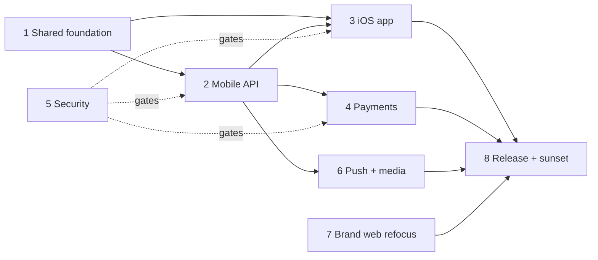

# Platform Split — Master Plan

**Decision (2026-07-25):** CreatorDocks splits into two surfaces:

- **CreatorDocks Web** (this Next.js app) → brand-first product: campaign creation, applicant review, submission approval, payments, admin.
- **CreatorDocks iOS** (new Expo/React Native app) → creator-first product: discover campaigns, apply, submit content, get paid, notifications.

**Locked decisions:**
1. iOS stack: **React Native + Expo** (EAS Build/Submit/Update).
2. Creator web dashboard: **kept fully functional until iOS reaches parity**, then sunset (redirect to App Store page).
3. Backend: **single Next.js backend**; mobile consumes a new versioned, token-authenticated API namespace (`/api/v1/*`). No second service.

## Current state (verified against the codebase)

- Next.js 16 (App Router) on Vercel, Neon Postgres via Prisma 7, Clerk auth (`@clerk/nextjs`), Stripe + Stripe Connect (creator onboarding, payment intents, payout release), UploadThing (media), Resend (email), Turnstile (bot protection), Zod 4.
- Models: `User` (Role BRAND/CREATOR/ADMIN, `stripeAccountId`/`stripeOnboarded`), `Campaign` → `Application` (unique per campaign+creator) → `Submission` → `Payout` (amount + platformFee, Stripe transfer). Waitlist models for pre-launch.
- Auth helper `lib/current-app-user.ts` resolves Clerk session → DB user (with clerkId self-repair). API guards: `lib/admin-api-guard.ts`, origin-check CSRF + **in-memory** rate limiting in `lib/request-security.ts`.
- Migration history is a clean baseline (`20260101000000_init` + drift-fix migration); production verified drift-free on 2026-07-25.

## Workstreams

| # | Doc | Workstream | Can start | Blocks |
|---|-----|-----------|-----------|--------|
| 1 | `01-shared-foundation.md` | Workspace restructure + shared schema package | immediately | 2, 3 |
| 2 | `02-mobile-api.md` | Versioned mobile API on the Next.js backend | after 1 (or in parallel with care) | 3, 4, 6 |
| 3 | `03-ios-app.md` | Expo creator app | scaffold immediately; features after 2 | 8 |
| 4 | `04-payments-payouts.md` | Stripe Connect on mobile + Apple compliance | after 2 core auth | 8 |
| 5 | `05-security.md` | Cross-cutting security (applies to all) | immediately | gates every merge |
| 6 | `06-notifications-media.md` | Push notifications + media uploads | after 2 core auth | 8 |
| 7 | `07-brand-web-refocus.md` | Web becomes brand-first | independent, any time | — |
| 8 | `08-release-qa-sunset.md` | TestFlight, App Store review, creator-web sunset | last | — |

### Dependency graph

**Parallelization for subagents:** W1 first (small, unblocks everything). Then W2 + W3-scaffold + W7 in parallel. Then W3-features + W4 + W6 in parallel. W5 is a checklist enforced on every workstream's acceptance criteria, plus its own hardening tasks. W8 last.

## Phases

- **Phase 0 — Foundation (W1, W5 hardening tasks):** workspaces, shared Zod schemas, distributed rate limiting, mobile-auth-compatible request security.
- **Phase 1 — API + scaffold (W2, W3 scaffold, W7):** `/api/v1` read paths + auth, Expo app shell with Clerk sign-in, brand-first web IA.
- **Phase 2 — Creator features (W3, W4, W6):** discovery/apply/submit flows, Stripe onboarding + payouts view, push + uploads.
- **Phase 3 — Ship & sunset (W8):** TestFlight beta, App Store submission, parity checklist, staged creator-web sunset.

## Ground rules for all subagents

1. **Read the target workstream doc fully before coding.** Each doc has scope, non-goals, tasks with IDs, and acceptance criteria.
2. **Security checklist in `05-security.md` is a merge gate** for every task. No endpoint ships without auth, object-level authorization, Zod validation, and rate limiting.
3. **Never touch production data or Stripe live mode** during development. All work against dev DB + Stripe test mode.
4. **Do not break the existing web app.** Creator web stays fully functional until W8 says otherwise. Existing `/api/*` routes keep working unchanged; mobile API is additive under `/api/v1/*`.
5. **This repo's AGENTS.md applies:** read `node_modules/next/dist/docs/` guides before writing Next.js code — this Next.js version differs from training data.
6. TDD per house rules: tests first, 80%+ coverage on new code. API routes get integration tests; shared schemas get unit tests; critical mobile flows get Maestro (or Detox) E2E before App Store submission.
7. Conventional commits (`feat:`, `fix:`, …); one workstream per branch/PR (`feat/w2-mobile-api-auth` style).

## Top risks

| Risk | Mitigation |
|------|-----------|
| Apple review rejection (payments) | W4 documents why Stripe Connect payouts are exempt from IAP (physical-world services, creators are paid — not charged). Brands never pay inside the app. |
| Apple review rejection (account deletion) | Guideline 5.1.1(v): in-app account deletion is **mandatory**. Built in W2/W3, not bolted on. |
| Mobile clients can't be force-upgraded | API versioning policy + min-supported-version endpoint + Expo OTA updates (W2-9, W3-2). |
| In-memory rate limiting is a no-op on serverless | W5-H1 moves it to durable storage before any public mobile endpoint ships. |
| CSRF origin checks reject mobile requests | W2-2 defines token-auth path that bypasses origin checks safely (origin checks exist for cookie auth only). |
| Solo review bottleneck | Each workstream doc has crisp acceptance criteria so work is verifiable without re-deriving context. |
